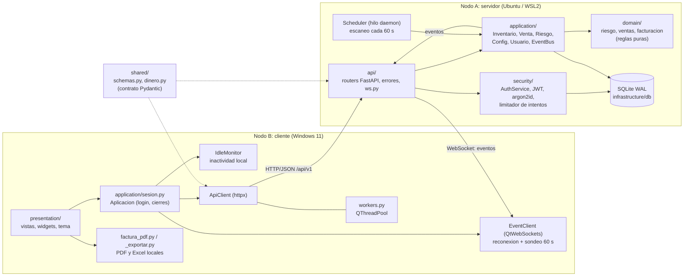
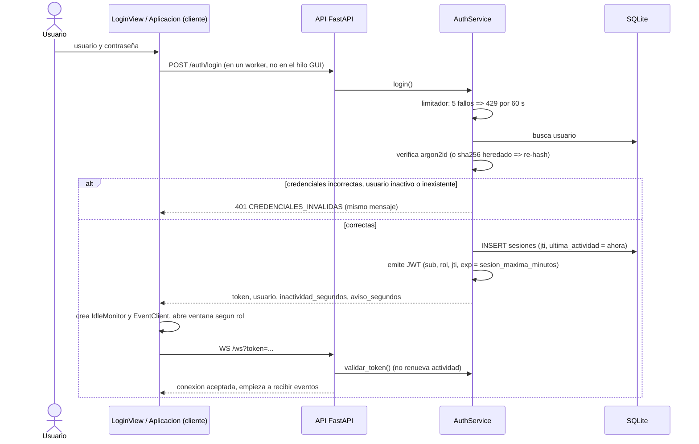
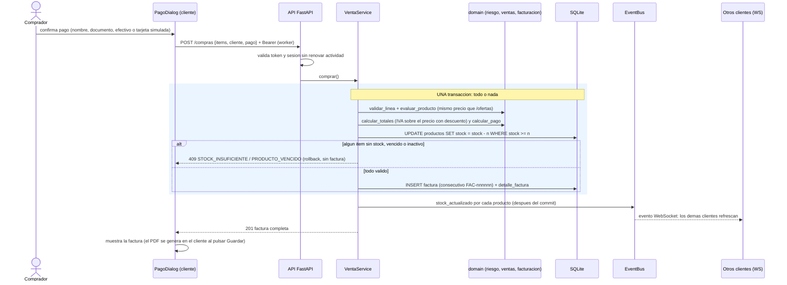
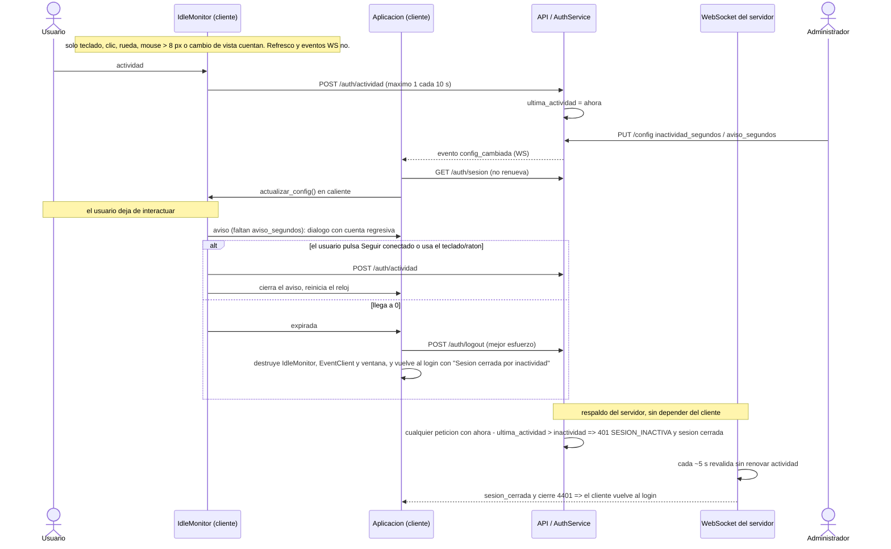
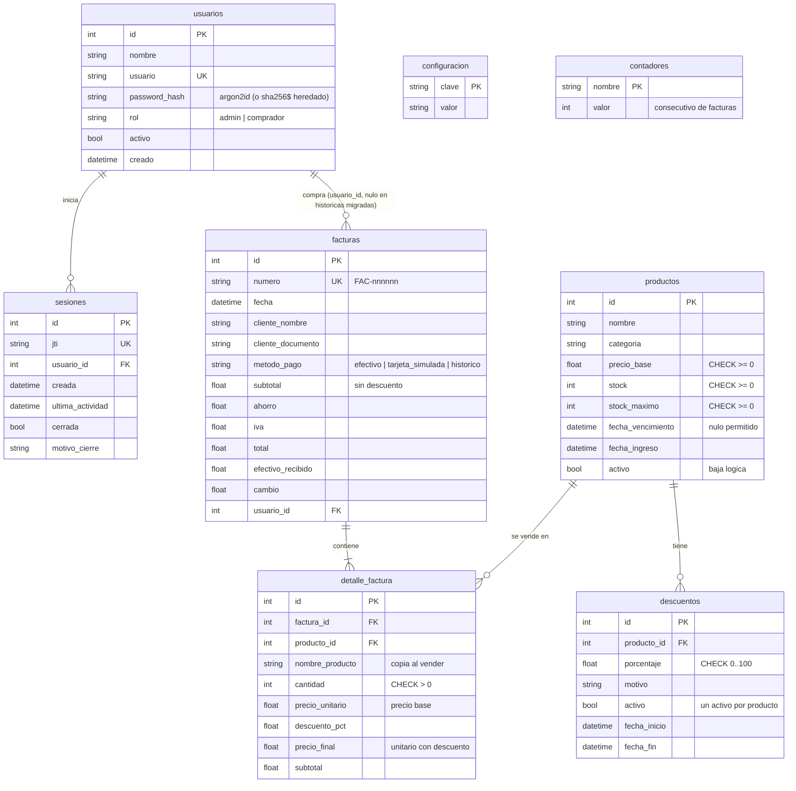

# Arquitectura de InventarioApp (versión final, distribuida en dos nodos)

Este documento describe lo que el repositorio implementa hoy. Todo lo afirmado se verificó contra el código en `server/`, `client/` y `shared/` y contra las pruebas de `tests/`. El contrato de la API está en [CONTRATO_API.md](CONTRATO_API.md), el despliegue en [DESPLIEGUE.md](DESPLIEGUE.md) y los resultados de pruebas en [INFORME_PRUEBAS.md](INFORME_PRUEBAS.md).

## 1. Nodos

| Nodo | Sistema | Tecnología | Responsabilidad |
|---|---|---|---|
| A, servidor | Ubuntu sobre WSL2 | FastAPI, uvicorn (un solo proceso), SQLAlchemy 2, SQLite en modo WAL, argon2-cffi, PyJWT | Única fuente de verdad: base de datos, reglas de negocio, autorización por rol, cálculo de descuentos y facturas, escaneo de riesgo en segundo plano, difusión de eventos |
| B, cliente | Windows 11 | PyQt6, httpx, QtWebSockets, ReportLab, openpyxl | Interfaz de usuario. No contiene reglas de negocio ni abre la base de datos: todo pasa por la API |

Comunicación: HTTP + JSON (REST, prefijo `/api/v1`) para las operaciones y un WebSocket (`/ws?token=<JWT>`, también en `/api/v1/ws`) para eventos del servidor al cliente. Puerto 8000 por defecto. El cliente se identifica con un token JWT en `Authorization: Bearer`.

## 2. Diagrama de componentes



`shared/` se importa en los dos nodos (modelos Pydantic y redondeo monetario) para que la vista previa del cliente coincida con la factura del servidor. No contiene lógica de negocio.

## 3. Diagramas de secuencia

### 3.1 Login y apertura de sesión



### 3.2 Compra con factura



### 3.3 Cierre por inactividad (configurable por el administrador)



## 4. Estructura de carpetas (real)

```
shared/                       contrato entre nodos
  schemas.py                  modelos Pydantic (DTOs, errores, eventos)
  dinero.py                   redondeo monetario (mitad hacia arriba), usado por ambos nodos
server/
  main.py                     arranque: python -m server.main (logs, uvicorn, 1 worker)
  logfilter.py                redacta token=<JWT> en los logs
  api/                        app.py (fabrica y lifespan), servicios.py (composicion), dependencias.py,
                              errores.py, ws.py (WebSocket), routers/ (auth, productos, riesgo, ventas,
                              config, usuarios, health)
  application/                inventario_service, venta_service, riesgo_service (+ Scheduler),
                              config_service, usuario_service, eventos (EventBus), errores
  domain/                     entities, riesgo, ventas, facturacion, dinero, errors (sin frameworks)
  infrastructure/db/          engine (pragmas), orm (tablas), repos, seed (configuracion por defecto),
                              migrar_legacy (importa la BD del sistema anterior)
  security/                   hashing (argon2id), tokens (JWT), sesiones (AuthService, limitador),
                              dependencias (roles), bootstrap (usuarios iniciales), rutas, errores
client/
  main.py                     arranque: python -m client.main
  application/                sesion.py (Aplicacion: login y cierres), mensajes.py
  infrastructure/             api_client (httpx), event_client (WS), idle_monitor, workers (hilos),
                              config (URL del servidor), factura_pdf, logfilter
  presentation/               views/ (login, main_window, buyer_window, dashboard, inventory, alerts,
                              usuarios, config, carrito, pago, factura), widgets/, styles/theme.py
deploy/                       wsl/*.sh (servidor), windows/*.ps1 (cliente y demo), seed_demo.py
tests/                        domain, application, infra, security, api, client, e2e
docs/                         este documento, contrato, despliegue, informe de pruebas, auditoria, capturas
```

## 5. Dependencias entre capas

En el servidor: `api -> application -> domain`; `application` usa `infrastructure/db` (repositorios) y `security` usa `infrastructure/db` y `domain.errors`. `domain` y `shared` no importan FastAPI, SQLAlchemy ni PyQt (verificado por búsqueda de imports). El cliente no importa nada de `server/` (solo `shared/`).

Precisión honesta: la capa `application` depende de las clases concretas de repositorio (`ProductoRepo`, `FacturaRepo`...) y de `sesion()`; no existen interfaces abstractas (puertos) para los repositorios. Solo el bus de eventos de seguridad es un `Protocol` (`sesiones.Bus`). La separación es de capas y de responsabilidades, no una arquitectura hexagonal estricta.

## 6. Modelo de datos (`server/infrastructure/db/orm.py`)



SQLite se abre con `PRAGMA foreign_keys=ON`, `journal_mode=WAL` y `busy_timeout=5000` en cada conexión. Los montos se guardan como `Float` pero el sistema los calcula y redondea en pesos enteros (`decimales_moneda = 0` por defecto, redondeo de la mitad hacia arriba, `shared/dinero.py`). `configuracion` es una tabla clave-valor (moneda, datos del negocio, IVA, umbrales, descuentos, intervalo de escaneo, `inactividad_segundos`, `aviso_segundos`, `sesion_maxima_minutos`); `seed.py` solo inserta las claves ausentes y borra `descuento_medio`.

## 7. Decisiones (ADR resumidas)

1. **FastAPI** para REST y WebSocket en el mismo proceso: modelos Pydantic compartidos y documentación automática en `/docs`.
2. **SQLite** se mantiene (alcance académico) con WAL y claves foráneas; el servidor es el único proceso que la abre.
3. **JWT + tabla `sesiones`.** El JWT identifica (`sub`, `rol`, `jti`, `exp` absoluto = `sesion_maxima_minutos`); la tabla decide la caducidad por inactividad. El valor `inactividad_segundos` se lee de la configuración en cada validación, así que un cambio del administrador aplica a sesiones abiertas y el servidor puede revocar (logout, usuario desactivado, contraseña o rol cambiados).
4. **Inactividad = entrada real del usuario**, reportada por el cliente (máximo una vez cada 10 s). El refresco automático y el WebSocket no la renuevan. Hay dos relojes: el local del cliente (cierra la interfaz) y el del servidor (invalida el token aunque el cliente no lo informe).
5. **Eventos por WebSocket con respaldo de sondeo** cada 60 s mientras el socket está caído, más una consulta al reconectar.
6. **Compra atómica**: una transacción, descuento de stock condicionado (`stock >= cantidad`) y factura con detalle en la misma transacción. La defensa contra la sobreventa es la condición en el `UPDATE`, no un bloqueo en memoria.
7. **Los vencidos no se venden ni tienen descuento**: se retiran (baja lógica) en el escaneo y la compra los rechaza aunque el escaneo aún no corra (`PRODUCTO_VENCIDO`).
8. **PDF y Excel en el cliente** (ReportLab y openpyxl) a partir de los datos del servidor; el servidor no depende de ellos ni de PyQt.
9. **Dependencias mínimas por nodo**: `requirements-server.txt` y `requirements-client.txt`. El servidor no usa pandas ni matplotlib.
10. **Credenciales sin valores fijos en el código**: se leen de variables de entorno o se generan al primer arranque (`server/security/bootstrap.py`).

## 8. Limitaciones conocidas (honestas)

- **Una sola máquina física.** Los dos nodos corren en la misma PC (Windows 11 y Ubuntu en WSL2) y se comunican por TCP/IP real a través del reenvío de `localhost` de WSL2. Se documenta el procedimiento para dos portátiles (DESPLIEGUE.md, sección 5), pero no se probó en otra PC, con firewall ni con `networkingMode=mirrored`.
- **HTTP sin TLS.** El token y la contraseña viajan sin cifrar. Es aceptable solo en una red de confianza; en producción iría detrás de HTTPS.
- **Sin réplicas ni balanceo; un solo servidor y una sola base de datos.** Si el servidor cae, el sistema no responde; el cliente lo detecta, lo muestra y cierra la sesión por inactividad localmente.
- **Un solo worker de uvicorn.** El limitador de intentos de login y el `EventBus` viven en memoria: un reinicio borra los bloqueos (verificado en la prueba E2E 7) y varios workers no compartirían eventos ni bloqueos. Los tokens sí sobreviven al reinicio porque la sesión está en la base de datos.
- **SQLite con carga limitada.** La concurrencia de compra se probó con hasta 12 hilos en pruebas de aplicación y 6 clientes en E2E; no hay pruebas de carga.
- **El token está solo en memoria del cliente** (no se persiste); no hay "recordarme".
- **Solo se probó Ubuntu (WSL2) para el servidor y Windows para el cliente.**
- **Las facturas son simuladas**: la tarjeta es simulada (no se piden ni guardan números) y el pie del PDF dice "Resolución simulada, sin validez fiscal". El IVA por defecto es 0 y se configura (la demo usa 19 %).
- **Las fechas** (vencimiento, facturas, sesiones) usan la hora local del servidor, sin zona horaria.

## 9. Mapa de requisitos

| Requisito | Dónde se implementa |
|---|---|
| RF-01, RF-02 | `server/security/` (`AuthService`, `requiere_rol`), `api/routers/auth.py`, `exigir_admin` en los servicios |
| RF-03 a RF-07 | `InventarioService`, `api/routers/productos.py`; exportación en `client/presentation/views/_exportar.py` |
| RF-08, RF-09, RF-22 | `server/domain/riesgo.py`, `RiesgoService` y `Scheduler` |
| RF-10, RF-11 | `api/routers/riesgo.py` (`/riesgo/resumen`, `/riesgo/alertas`) |
| RF-12 | `GET /ofertas` |
| RF-13 | `ConfigService`, `api/routers/config.py` |
| RF-14, RF-24 | `/auth/logout`, `/auth/actividad`, `/auth/sesion`, `IdleMonitor`, `Aplicacion` |
| RF-15 a RF-17 | `client/presentation/views/carrito.py` y `carrito_modelo.py` (local) |
| RF-18, RF-19, RF-20 | `POST /compras`, `VentaService`, `server/domain/facturacion.py`, tablas `facturas` y `detalle_factura` |
| RF-21 | `client/infrastructure/factura_pdf.py` |
| RF-23 | `UsuarioService`, `api/routers/usuarios.py`, `usuarios_view.py` |
| RF-25 | `EventBus`, `api/ws.py`, `EventClient` |
| RNF-01 | argon2id (`hashing.py`), JWT, autorización en servidor |
| RNF-02 | `Scheduler` en el servidor, `workers.py` en el cliente |
| RNF-03 | transacción por caso de uso (`sesion()`), WAL, FK y CHECK |
| RNF-05 | servidor en Ubuntu + cliente en Windows, `platformdirs` |
| RNF-06 | separación server / client / shared, capas del servidor |
| RNF-07 | `server/logfilter.py`, `client/infrastructure/logfilter.py`, `GET /health` |
